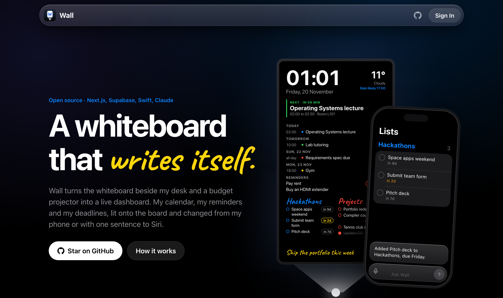
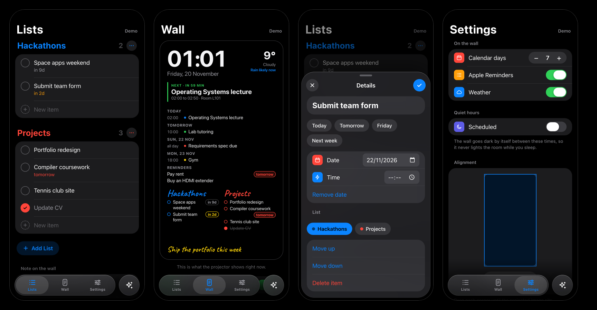
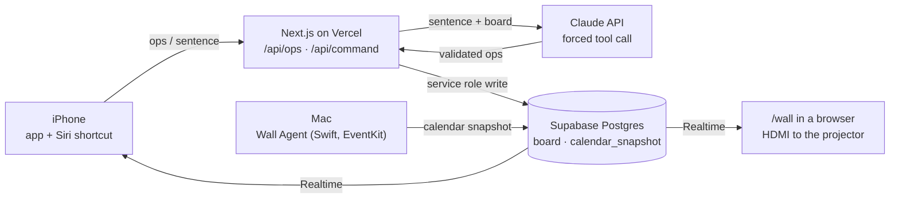

<p align="center"></p>
<h1 align="center">Wall</h1>
<p align="center"><b>A whiteboard that writes itself.</b><br>
A budget projector, a whiteboard, and a live dashboard you change from your phone or with one sentence to Siri.</p>
<p align="center"><a href="https://wall.eugeniobusta.com">wall.eugeniobusta.com</a> · <a href="SETUP.md">Setup guide</a> · <a href="#how-it-works">How it works</a></p>



## What it is

There is a 55 by 90 cm whiteboard beside my desk. A small projector, turned on its side, lights it with the things I need
to see without picking up my phone: the time, the weather, my next class, the week from Apple Calendar, my open
Apple Reminders, and my own lists with countdowns that turn amber and then red as a deadline gets close.

I change it from an app on my phone, or by talking. "Hey Siri, Wall. Cassini hackathon on the 27th." Claude turns the
sentence into a structured change, and the wall updates about a second later.



## Features

| | |
| --- | --- |
| **Lists with countdowns** | Any number of coloured lists. Due dates show as "in 9d", "in 3d", "tomorrow" and change colour as they approach. |
| **Apple Calendar and Reminders** | A small Swift app on the Mac reads them with EventKit and uploads a snapshot every five minutes and seconds after any change. |
| **Ask in plain language** | Type, dictate, or use the Siri shortcut. Claude answers through a forced tool call, so the reply is always a list of validated operations and one spoken sentence. |
| **Corner pin** | Drag four corners on the phone until the image sits square on the board. One CSS `matrix3d` does the perspective warp. |
| **Quiet hours and power** | The wall goes dark on a schedule, or when you say "goodnight". Black is no light on a projector. |
| **Feels native on iPhone** | Add it to the home screen and it runs full screen with the system font, grouped lists, sheets, and a floating glass bar. |
| **Private** | One account can read. Nothing can be written from a browser. Sign ups are closed. |
| **Self healing display** | The wall page holds a wake lock and reloads itself when a new version is deployed. |

## How it works



| Part | What it does |
| --- | --- |
| `app/wall` | The projector page. A fixed 720 by 1280 canvas scaled to the window and warped to the board. |
| `app/edit` | The app. Lists, a live preview of the wall, settings, and the Ask field. |
| `app/page.tsx` | The public landing page. Its hero is the real canvas and the real board logic running on made up data. |
| `lib/board.ts` | The board model and `applyOps`, the only way the board ever changes. Used by the server, the app and the demo. |
| `app/api/ops` | Applies operations on the server with optimistic concurrency on the row. |
| `app/api/command` | Sends the sentence, the board and the calendar to Claude and applies the operations it returns. Also what Siri calls. |
| `supabase/schema.sql` | Two single row tables, row level security, Realtime. |
| `agent/` | Wall Agent: a background macOS app that uploads Apple Calendar and Reminders. |
| `display/` | Wall Display: a tiny macOS app that opens the wall in a chromeless window and keeps the screen awake. |

The whole board is one JSON row. Every change is a small operation such as `addItem` or `setPower`, validated and applied on
the server. Supabase Realtime pushes the new row to every open wall and phone.

## Try it in one minute

No accounts needed. Without Supabase keys the app runs in demo mode and keeps its data in the browser.

```bash
git clone https://github.com/eugeniobusta/wall.git
cd wall
npm install
npm run dev
```

Open `localhost:3000/edit` for the app and `localhost:3000/wall` for the projector page, side by side.

## Build your own

You need a projector with HDMI, a pale wall or whiteboard, and free Supabase and Vercel accounts. A Mac is only needed for
Apple Calendar and Reminders. An Anthropic API key is only needed for the Ask field and Siri, and each command costs well
under a cent.

The full walkthrough is in [SETUP.md](SETUP.md). In short:

1. Create a Supabase project and run `supabase/schema.sql` with your email in it.
2. Copy `.env.example` to `.env.local` and fill it in.
3. Deploy to Vercel with the same variables.
4. Run `agent/install.sh` on your Mac for the calendar.
5. Run `display/install.sh`, open Wall Display, and drag it onto the projector.

## Configuration

| Variable | Needed | What it is |
| --- | --- | --- |
| `NEXT_PUBLIC_SUPABASE_URL` | yes | Your Supabase project URL. |
| `NEXT_PUBLIC_SUPABASE_ANON_KEY` | yes | The publishable key. Safe in the browser, because row level security does the protecting. |
| `SUPABASE_SERVICE_ROLE_KEY` | yes | The secret key. Server and Mac agent only. |
| `ALLOWED_EMAIL` | yes | The one account that may sign in and edit. |
| `WALL_API_TOKEN` | for Siri | A random string of 32 characters or more that the shortcut sends. |
| `ANTHROPIC_API_KEY` | for Ask | Used by `/api/command`. |
| `WALL_MODEL` | no | Defaults to `claude-haiku-5-5`. |
| `NEXT_PUBLIC_WALL_LAT`, `NEXT_PUBLIC_WALL_LON` | no | Where the weather is read for. |
| `NEXT_PUBLIC_WALL_TIMEZONE` | no | The timezone used to resolve "tomorrow" and "friday". |

## Security

This runs on a public domain, so the rules are strict and simple.

* **Reads.** Row level security allows `select` only for the signed in account whose email matches. Anonymous visitors have no table privileges at all.
* **Writes.** No browser can write. Both API routes check the caller first (a Supabase session for `ALLOWED_EMAIL`, or the shortcut token compared in constant time) and then write with the service role.
* **Input.** Every operation is validated in `applyOps`: dates, times, colours, corner positions, text length, and caps on lists and items. Claude's output goes through the same gate.
* **Prompt injection.** Calendar and reminder text is passed to Claude as data with an explicit instruction not to act on it, and the worst a hostile calendar invite could do is edit a list.
* **Headers.** A content security policy limits connections to the app itself, your Supabase project and Open-Meteo. Framing is same origin only.
* **Secrets.** Only in environment variables and in a `chmod 600` config file for the Mac agent. Never in the repository.

## About the projector

Mine is a Magcubic HY300 Pro. Its stock Android firmware is known to ship with malware that turns the device into a proxy
for other people's traffic, so mine has never joined a network and never will. It is used only as an HDMI screen. If you
want the wall to run without a laptop attached, put a small computer such as a Raspberry Pi on the HDMI port and open
`/wall` in a kiosk browser. Do not put the projector itself online.

## Questions

**Do I need a Mac?** Only for Apple Calendar and Reminders. Without the agent the wall still shows the clock, weather and your lists.

**Do I need this exact projector?** No. Anything with HDMI works. The canvas is portrait, so turn the projector on its side or project in landscape and use the corner pin.

**Why is the app dark only?** The wall is light on black, and the app matches it. A dark app also keeps the status bar correct when installed on the home screen.

**Is this real Liquid Glass?** Apple does not expose its glass material to web pages, so the floating bar is built from `backdrop-filter`, a light rim and a soft lift, following Apple's guidance that glass belongs to the navigation layer and never to content.

## License

[MIT](LICENSE). Built by [Eugenio Bustamante](https://eugeniobusta.com) in Dublin.
